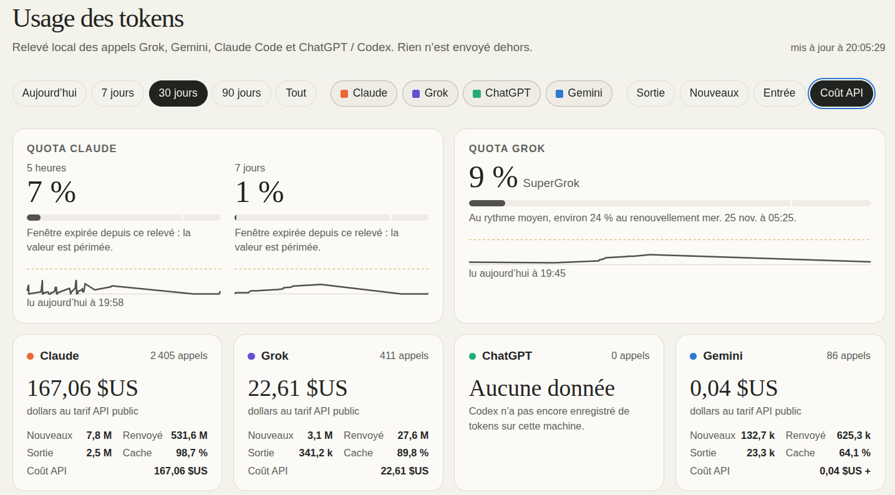

# tokenscope

Tableau de bord local pour suivre la consommation de tokens et le coût estimé de vos outils d'IA en ligne de commande : **Claude**, **Grok**, **Gemini** et **ChatGPT (Codex)**.

- Lit uniquement les journaux déjà présents sur votre machine.
- N'appelle aucune API et n'envoie rien à l'extérieur.
- N'expose aucun contenu de conversation, seulement des compteurs.
- Aucune dépendance : bibliothèque standard Python uniquement.



## Utilisation

```bash
python3 server.py
```

Ouvrez ensuite <http://127.0.0.1:8765>. Le serveur n'écoute que sur `127.0.0.1`.

## Sources lues

| Outil | Emplacement |
|---|---|
| Claude | `~/.claude/projects`, `~/.config/Claude/plan-usage-history.json` |
| Grok | `~/.grok/sessions`, `~/.grok/logs/unified.jsonl` |
| Gemini CLI | `~/.gemini/tmp` |
| Antigravity | `~/.gemini/antigravity-cli/brain` |
| ChatGPT / Codex | `~/.codex` |

Une source absente est simplement ignorée.

## Tarifs

Les coûts sont calculés à partir de `prices.json` (dollars par million de tokens, relevés sur les pages officielles listées dans le fichier). Le serveur relit ce fichier dès qu'il change : mettez-le à jour quand les tarifs évoluent.

Les montants sont des estimations : ils ne remplacent pas la facturation des fournisseurs.

## Structure

- `server.py` : collecte, agrégation et serveur HTTP
- `web/index.html` : interface
- `prices.json` : tarifs

## Licence

[MIT](LICENSE)
